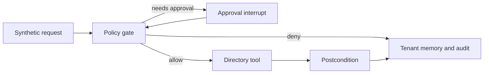

# Architecture

One identity operation moves through a LangGraph thread. The same decisions are described, and not executed, as an AWS Step Functions state machine.

## Request

`Harness.start` builds the graph input from the principal. The body can carry `request_id`, `operation`, `target`, `role_name`, and a `justification`. The justification is not copied into graph state, memory, or the audit log. A `tenant` field on the body is ignored. Credential-shaped keys are rejected before `invoke`.

Request ids start with `SYN-REQ-`. User ids start with `SYN-USER-`. The export target is the literal `SYN-AUDIT`.

## Policy

`evaluate` reads the operation field. The map is fixed:

| Operation | Risk | Who may request it |
| --- | --- | --- |
| `lookup-account` | low | reader, operator, approver |
| `disable-account` | high | operator, approver |
| `grant-role` | high | operator, approver |
| `export-audit` | high | operator, approver |

A low-risk call that passes the checks returns `allow` and names the tool. A high-risk call with no approval returns `needs-approval` and names no tool. A high-risk call with an approval is allowed only when the approval id starts with `APR-`, the tenant and request id match, the approver role is `approver`, and the approver is a different actor. Anything else is `deny`.

An unknown user id in this tenant and a user id that exists only in another tenant produce the same reason, `unknown target`.

## Graph

Nodes, in order: intake, policy, and then one of approval, execute, or close. Approval interrupts. Resume runs recheck, which calls `evaluate` again. Execute calls `evaluate` a further time and only then calls `Directory.apply`. Verify compares the directory with the tool result. Close writes one memory record and one audit line.

The checkpointer is `SqliteSaver`. The thread id is the request id. `recovery_check` closes the database after the interrupt and opens a new harness on the same file. The resumed thread disables the account once.

`force_tool_down` makes execute return `failed` without calling `apply`. The account stays active.

## Directory and memory

The directory is seeded from [`data/synthetic_directory.json`](../data/synthetic_directory.json). `apply` stores the result under the request id. A second call with that id returns the stored result and sets `idempotent_replay`.

Memory is a dict of tenant, then key. `read` on another tenant returns `None`. Export copies audit rows whose tenant field matches the caller.

## Step Functions document

[`deploy/stepfunctions/identity-workflow.asl.json`](../deploy/stepfunctions/identity-workflow.asl.json) uses account `000000000000`. Policy, recheck, execute, and verify are tasks. Both choice states default to Close. WaitForApproval uses a task token and its failure and timeout paths go to Close, not to Execute. Catch paths on the tasks also go to Close.

[`deploy/iam/tool-role.json`](../deploy/iam/tool-role.json) allows `states:StartExecution`, `states:DescribeExecution`, and `lambda:InvokeFunction` on the four placeholder function names. It does not grant `iam:*`, `secretsmanager:*`, or `Resource: *`.

`identityguard.asl` walks that document in process. Nothing in the test suite creates a state machine.

## Evaluation

[`evals/cases.json`](../evals/cases.json) holds ten examples. `run_suite` gives each case a new directory and a new database. The committed table is [`evals/replay-report.md`](../evals/replay-report.md). A second run of the suite produces the same case id, pass bit, and status.

## Observability

`GET /metrics` publishes two process counters and says they are not cloud telemetry. The audit log is JSONL. Runbooks for a stuck approval and for rollback live in [`docs/runbooks`](runbooks).
